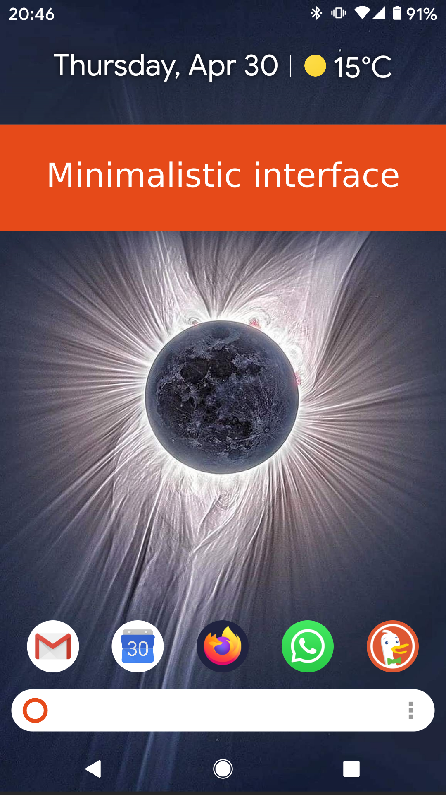
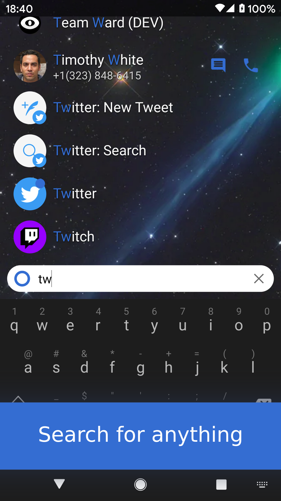
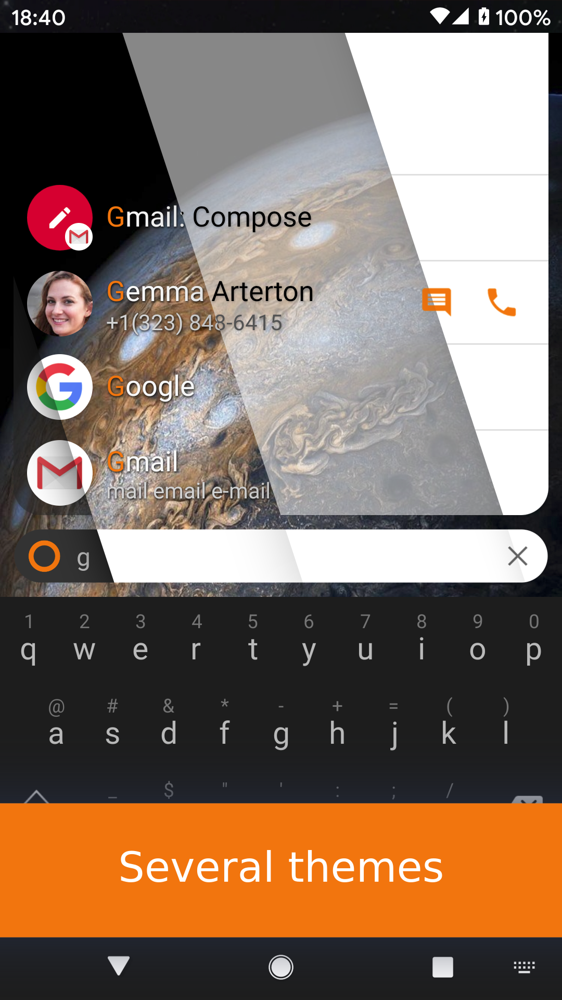
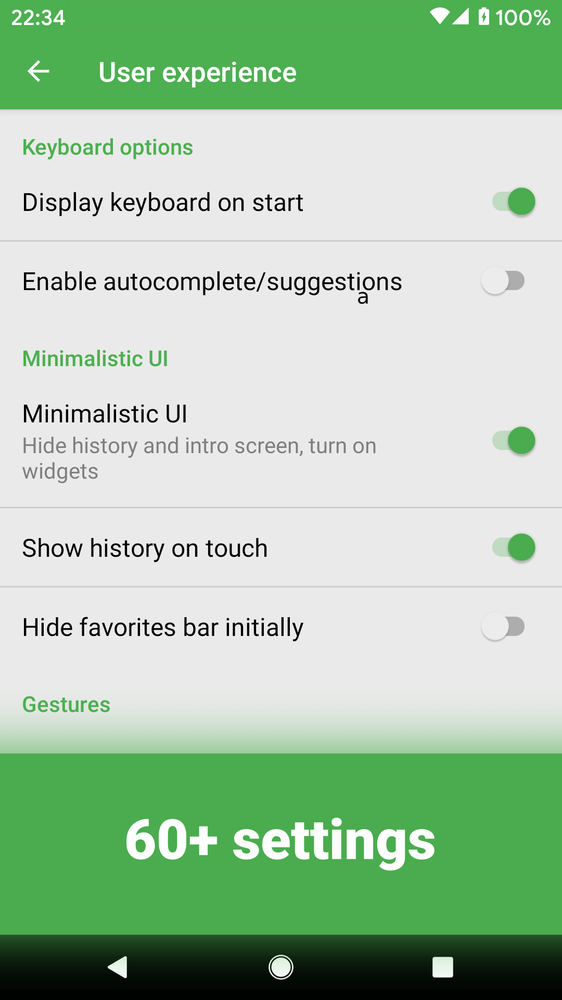

# KISS

> **MSI 5 Lite Launcher edition** — this fork turns KISS into a launcher dedicated to the
> MSI App Player 5 / BlueStacks emulators (Android 7.1, 9 and 11, x86_64), used with a mouse,
> a keyboard and a landscape monitor:
>
> - the home screen is a centered **grid of the installed apps and games** (icon + one-line name),
>   the search bar sits at the top, favorites are docked at the bottom;
> - **landscape only**, dark opaque theme (`#0D0D0F`), no wallpaper, blur, transparency or list animations;
> - the soft keyboard **never opens on its own** (no automatic focus of the search field), so it does not
>   fight with the emulator key mapping; typing on the physical keyboard still searches, arrows / Enter
>   navigate the grid;
> - **right click** (or long click) on an app: *App info*, *Hide app*, *Uninstall*;
> - phone apps that are useless on an emulator (contacts, dialer, camera, gallery, messaging...) are hidden
>   on first launch, see `msi_hidden_packages` in `app/src/main/res/values/arrays.xml`;
> - removed: contacts, phone numbers, call history, web search engines, timers, tags, widgets and
>   the history screen (and the `READ_CONTACTS`, `CALL_PHONE`, `READ_PHONE_STATE`, `SET_ALARM` permissions);
> - icons are kept in an in-memory `LruCache`: coming back from a game does not read them again from disk,
>   and the app list is only reloaded when a package is installed, removed or updated.
>
> The app name is set in `app/src/main/res/values/strings_msi.xml`.

An Android launcher not spending time and memory on stuff you'd rather do.

Libre software, licensed [GPLv3+](https://github.com/Neamar/KISS/blob/master/LICENSE): use, see, [change](CONTRIBUTING.md) and share at will.

Type the first letters of apps, contact names, or settings—and click.
Results clicked more often are promoted.

_No more idle app browsing_.

That's it. Fast and efficient.

Join the [beta program](https://play.google.com/apps/testing/fr.neamar.kiss/) to test the latest version.

Join the [Hosted Weblate](https://hosted.weblate.org/engage/kiss/) translation platform to help translate the app.

Public Telegram chat: https://t.me/joinchat/_eDeAIQJU1FlNjM0

|  |  |  |  |
| :-----------------------------------------------------------------------------------------------------------------------------------: | :------------------------------------------------------------------------------------------------------------------------------------: | :-----------------------------------------------------------------------------------------------------------------------------------------: | :-----------------------------------------------------------------------------------------------------------------------------: |
